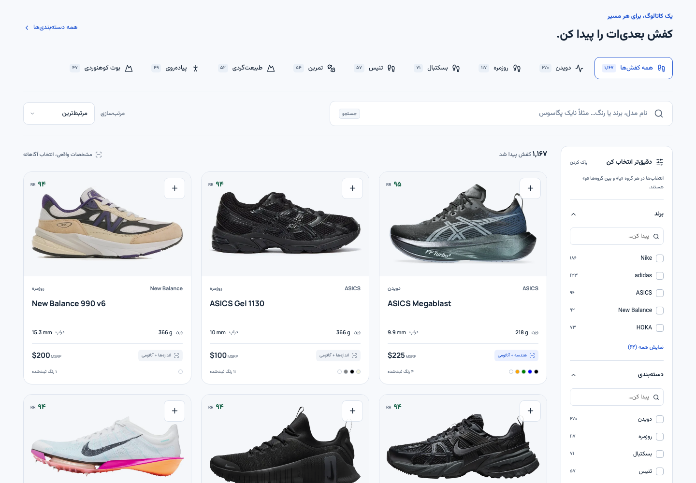
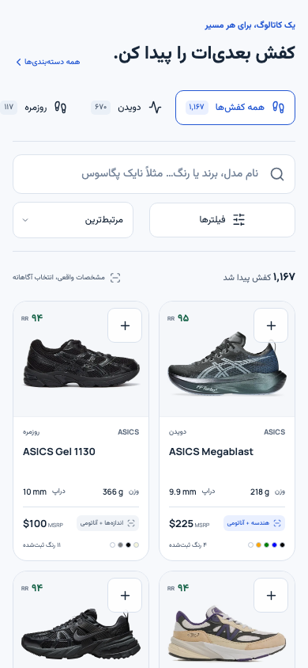
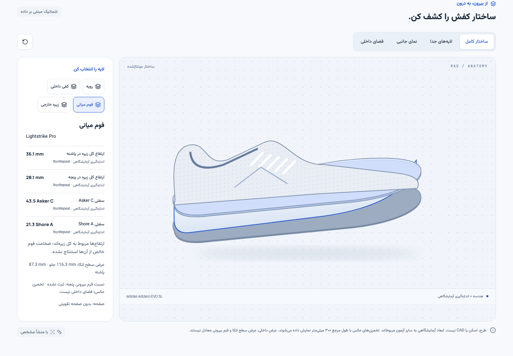
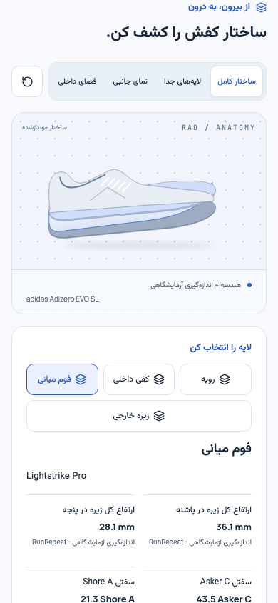
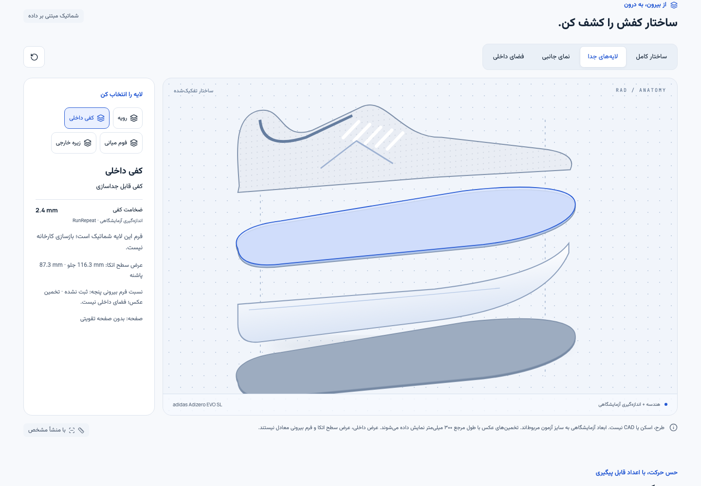
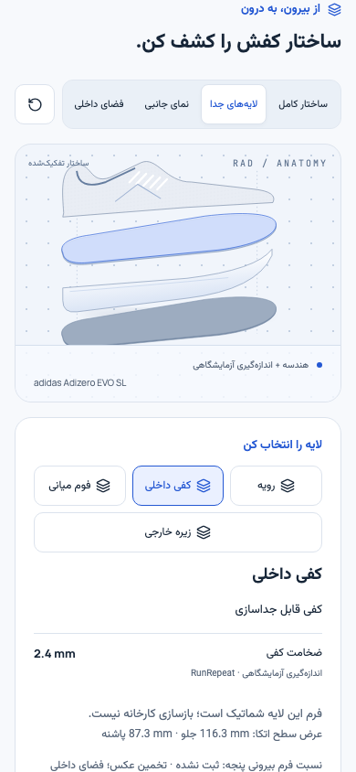
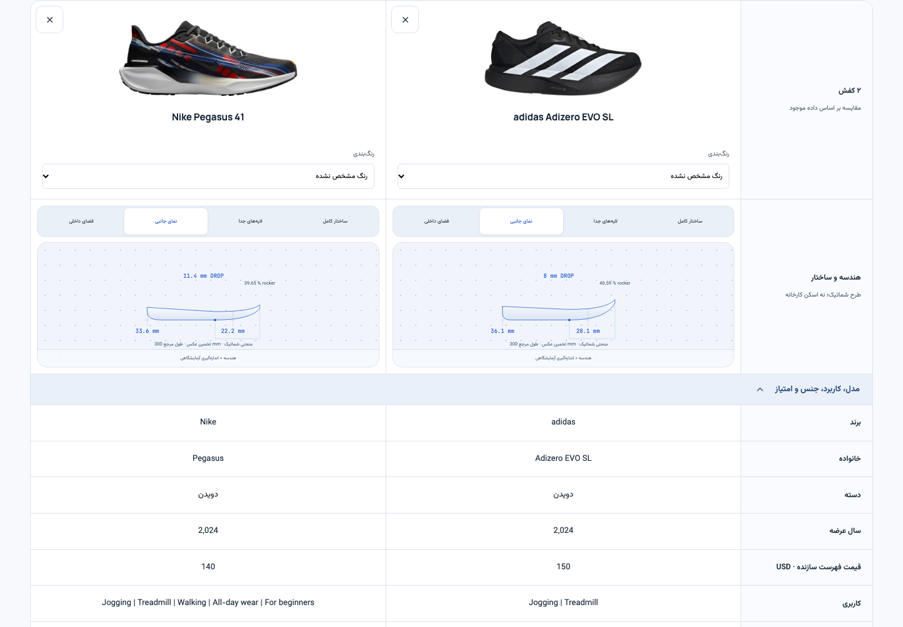
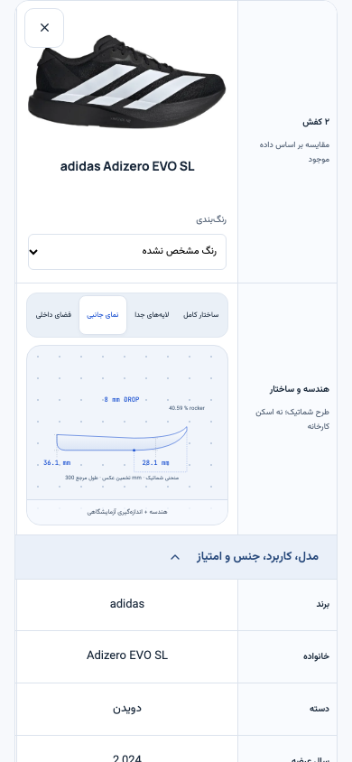

# Review screenshots

**Current dark redesign:** see the [before/after matrix](redesign/delivery.md#before-and-after) and `redesign/after/`. The captures below document the preserved bright baseline.

Captured from the real local PostgreSQL-backed application in Chromium. Full desktop, tablet and mobile journey tests passed. Captures use reduced motion to freeze settled states; the regular journey tests exercise ordinary motion as well.

| Screen | Desktop · 1440×1000 | Mobile · 390×844 |
|---|---|---|
| Catalog |  |  |
| Assembled anatomy |  |  |
| Exploded construction |  |  |
| Comparison |  |  |

Opening interaction: [desktop](screenshots/home-desktop.png), [mobile](screenshots/home-mobile.png).

Tablet captures at 820×1180: [catalog](screenshots/catalog-tablet.png), [assembled](screenshots/anatomy-tablet.png), [exploded](screenshots/exploded-tablet.png), [comparison](screenshots/comparison-tablet.png), [opening](screenshots/home-tablet.png).
